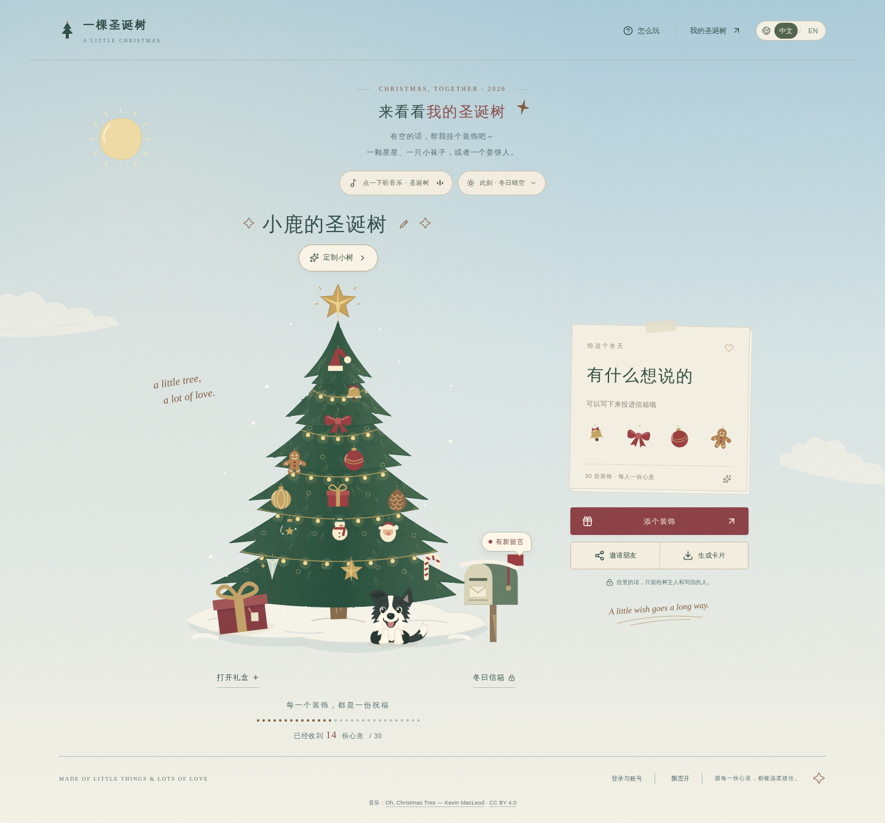
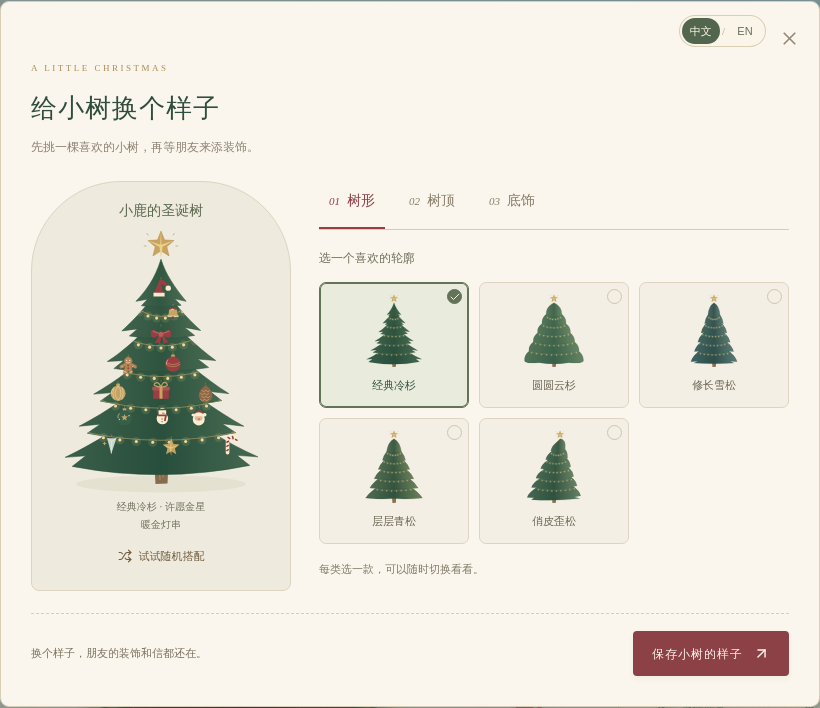
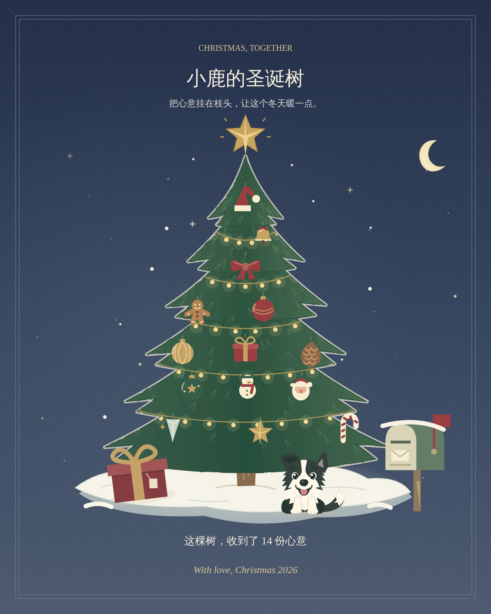
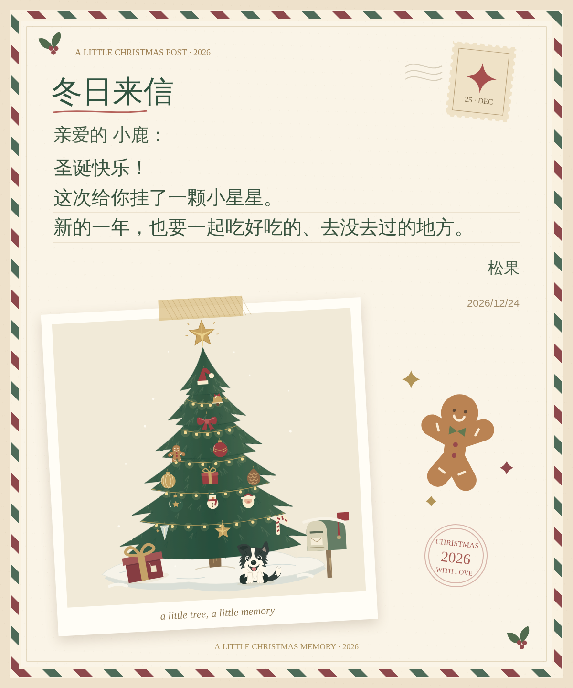
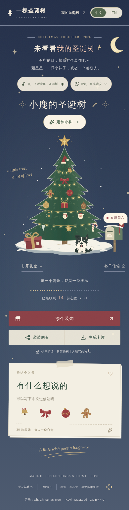

<div align="center">

# 🎄 一棵圣诞树

**给自己一棵树，邀请朋友来添个装饰。**

一颗星星、一只小袜子，或者一个姜饼人。<br/>
有什么想说的，也可以写下来投进信箱。

**[打开网站，种下你的小树 →](https://cool-pavlova-b2ef63.netlify.app/)**

手机与电脑 · 中文 / English · 邮箱验证码登录

</div>



> 所有配图均使用演示昵称和虚构留言，不包含真实用户的个人资料或私信。

## 一起，把小树装饰起来

这是一个可以和朋友一起参与的圣诞互动网站。

登录、填一个昵称，挑选喜欢的小树，再把专属链接发给朋友。每个人可以挂上一件装饰，也可以顺手写一封小信。等小树慢慢热闹起来，就把这一刻保存成卡片。

暖白纸感、深绿松树、酒红礼盒和柔和金色灯光，配上飘雪与音乐，像一本可以翻进去玩一会儿的圣诞绘本。

| 可以做什么 | 小小的细节 |
| --- | --- |
| 🎁 给小树添装饰 | 30 个挂点、30 款预设装饰；每个账号在每棵树上只能挂一件，之后可以更换。 |
| 🌲 定制自己的小树 | 5 种树形 × 5 款树顶 × 5 套底饰，共 125 种搭配；修改外观会保留已有装饰和信件。 |
| ✉️ 写一封私密来信 | 留言选填，可以署名或匿名；网站内仅树主人和写信人可以查看。 |
| 🔴 发现新留言 | 信箱出现“有新留言”气泡，未读信件带红点；打开并成功标记已读后消失。 |
| 🖼️ 收藏圣诞回忆 | 生成当前小树的分享卡片，也能把单封来信做成带小树贴画的信件卡。 |
| 🐾 和小边牧打个招呼 | 它会打盹、走动闻闻、蹲坐吐舌头；点击会有动作反馈和两声小狗叫。 |
| ☀️ 看看小树的不同时刻 | 背景随当地时间变化，也可以手动预览晴天、日落、暮色与夜晚。 |
| 🎵 听一会儿圣诞音乐 | 支持播放与暂停；手机上若未自动响起，点击音乐按钮即可。 |

## 从一棵空树开始

1. **拥有小树**：打开网站，用邮箱验证码登录，首次填写昵称。
2. **挑选样子**：选择树形、树顶和底饰，也可以试试随机搭配。
3. **邀请朋友**：复制自己的小树链接，发给想邀请的人。
4. **收到装饰与来信**：朋友打开链接即可看树，登录后可以挂装饰、写信，也能创建自己的树。
5. **留下这一刻**：生成小树卡片，或打开喜欢的来信，保存成一张小卡片。

分享网站本身，请使用上方的普通入口；邀请朋友装饰某一棵树，请使用站内“邀请朋友”生成的专属链接。

### 小树的样子，由你来选



### 两种卡片，两种收藏方式

<table>
  <tr>
    <th width="50%">小树卡片</th>
    <th width="50%">冬日来信</th>
  </tr>
  <tr>
    <td></td>
    <td></td>
  </tr>
  <tr>
    <td>记录小树当下的样子，不包含私信内容。</td>
    <td>收藏一封来信，配上当前小树的贴画。</td>
  </tr>
</table>

卡片在浏览器中生成。微信内可以长按预览图片保存；支持文件分享的手机浏览器可以调用系统菜单，电脑端可以下载 PNG。信件卡片包含所选留言的正文和署名，保存后由你决定是否分享。

<details>
<summary><strong>📱 展开看看手机版的夜晚</strong></summary>

<p align="center">
  
</p>

</details>

## 给想研究代码的朋友

| 部分 | 使用的技术 |
| --- | --- |
| 前端界面 | React 19、TypeScript、Vite 8 |
| 插画与动效 | SVG、CSS 动画 |
| 图片生成 | Canvas、浏览器 Blob 与文件分享能力 |
| 服务端接口 | Netlify Functions |
| 数据存储 | Netlify Database / PostgreSQL |
| 邮箱登录 | SMTP、Nodemailer、一次性验证码 |
| 测试 | Node.js Test Runner、PGlite |

### 目录结构

当前仓库把应用源码放在 `christmasTree/` 子目录，README 与展示配图位于仓库根目录。

```text
.
├── README.md
├── docs/
│   └── readme/                 # 本文的演示截图与卡片
└── christmasTree/
    ├── app/                    # 应用入口、页面和全局样式
    ├── components/             # 小树、礼盒、信箱、小狗与卡片组件
    ├── lib/                    # 业务逻辑、登录、权限、翻译与卡片绘制
    ├── netlify/
    │   ├── functions/          # 服务端 API
    │   └── database/migrations/ # 数据库结构迁移
    ├── public/                 # 图标、音乐、音效与来源说明
    ├── tests/                  # 自动化测试
    ├── netlify.toml            # 构建与托管配置
    └── package.json
```

### 本地检查与前端开发

使用 Node.js 22.16 或兼容的更新版本。在仓库根目录执行：

```bash
cd christmasTree
npm ci
npm test
npm run build
```

启动 Vite 前端开发服务：

```bash
npm run dev
```

`npm run dev` 只启动前端，不会自动提供登录、数据库和信箱接口；完整功能需要配置后端。当前 API 会校验 `lib/wechat-config.ts` 中的 `SITE_ORIGIN`，因此本地联调或部署到新域名时，需要同步调整允许的访问来源，并准备对应的服务端环境。

测试使用本地 PGlite 数据库与模拟发信逻辑，无需读取线上私信或发送真实验证码。测试范围包括登录、私信访问权限、装饰限制、未读状态、树形定制和卡片生成等逻辑。

### 部署配置要点

按当前仓库结构连接 Netlify 时，应用目录和构建配置为：

| 配置 | 值 |
| --- | --- |
| Base directory | `christmasTree` |
| Build command | `npm run build` |
| Publish directory | `dist`，相对于应用目录 |
| Functions directory | `netlify/functions`，相对于应用目录 |

同时需要为自己的站点配置 Netlify Database，并确保 `netlify/database/migrations/` 中的数据库迁移按编号顺序应用。登录、装饰和信箱依赖服务端接口，完整部署需要包含 Functions 和数据库。配置方式可参考 [Netlify 子目录构建说明](https://docs.netlify.com/build/configure-builds/monorepos/) 与 [Netlify Database 文档](https://docs.netlify.com/build/data-and-storage/netlify-database/)。

邮箱登录所需的服务端环境变量：

| 变量 | 说明 |
| --- | --- |
| `EMAIL_LOGIN_ENABLED` | 设置为 `true` 启用邮箱登录 |
| `EMAIL_AUTH_SECRET` | 32 字节随机值的十六进制表示，共 64 位小写十六进制字符 |
| `SMTP_HOST` | 发件邮箱的 SMTP 服务器 |
| `SMTP_PORT` | 默认 `465`（TLS），也支持 `587`（STARTTLS） |
| `SMTP_USER` | 发件邮箱账号 |
| `SMTP_PASS` | 发件邮箱的 SMTP 授权码 |

这些配置只保存在服务端，不使用 `VITE_` 前缀，也不提交到仓库。已有用户的站点应保持 `EMAIL_AUTH_SECRET` 稳定，避免影响邮箱身份匹配。主登录流程使用邮箱；源码中的微信与历史账号迁移接口用于兼容已有账号。

## 音乐与音效

- 背景音乐：**Oh, Christmas Tree — Kevin MacLeod**，使用 CC BY 4.0 授权。来源、署名和播放副本处理说明见 [音乐说明](christmasTree/public/audio/CREDITS.txt)。
- 小狗音效：**Happy puppy barks — Mixkit**。来源、授权链接与剪辑说明见 [音效说明](christmasTree/public/audio/COLLIE-CREDITS.txt)。

复用音频时请保留对应署名，并遵循各素材的授权条款。

---

<div align="center">

**每一个装饰，都是一份祝福。**

[来种一棵自己的圣诞树 🎄](https://cool-pavlova-b2ef63.netlify.app/)

</div>
